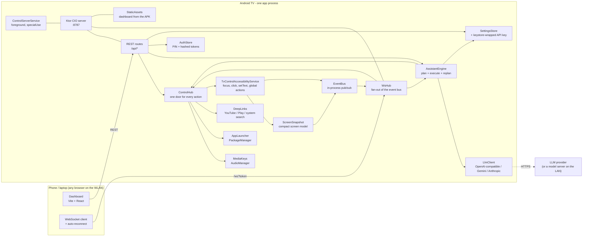

# Architecture

## 1. Requirements

**Functional**

| # | Requirement |
| --- | --- |
| F1 | Run in the background on Android TV and stay reachable on the LAN |
| F2 | Provide remote control over Wi-Fi: D-pad, OK, Back/Home/Recents, volume, playback |
| F3 | "Autotyping": write text into whatever field is focused on the TV, including other apps |
| F4 | Move the TV's own focus/selection (navigation control) without a physical remote |
| F5 | Expose a minimal web dashboard, openable from any device on the WLAN, acting as the controller |
| F6 | AI assistance: natural language in, a plan of TV actions out, with live progress |
| F7 | Pairing that is trivial from a phone but not open to the whole network |

**Non-functional**

| # | Requirement |
| --- | --- |
| N1 | Button latency low enough to feel like a remote (< ~150 ms LAN round trip; repeats go over one WebSocket) |
| N2 | Survive TV sleep/boot without the user re-finding the TV (boot receiver + sticky foreground service) |
| N3 | No cloud dependency for core control: only the assistant needs the network |
| N4 | Secrets (LLM key, pairing tokens) never stored in the clear |
| N5 | Sideloadable with no root, no Play Services requirement, no ADB permission at runtime |
| N6 | Small enough to run comfortably on a cheap TV box (single process, one server, no image pipeline) |

**Constraints**

- No root, no ADB, no INJECT_EVENTS: the control engine must be accessibility-only (user decision).
- Custom REST/WebSocket protocol rather than reverse-engineering the Google TV remote protocol (user decision).
- Cloud LLM, configured from the dashboard, provider-agnostic (user decision).
- The dashboard must be served by the TV itself: no extra host on the LAN.

## 2. System diagram

## 3. Module boundaries

| Module | Responsibility | Owns | Exposes |
| --- | --- | --- | --- |
| `accessibility` | Turn semantic actions into real focus/clicks/text on any app; build the screen snapshot | `ScreenSnapshot`, node summaries | `navigate/activate/scroll/global/inputText/readScreen` |
| `control` | Route a logical button to the right mechanism; app launch; deep links; volume/media | `MetricKey` vocabulary | `key/text/launch/search/volume/snapshot` |
| `server` | LAN HTTP + WebSocket surface, auth guard, static dashboard, mDNS | The listening socket, WS sessions | `/api/*`, `/ws` |
| `ai` | Prompt construction, provider calls, plan parsing, execution and replanning | Assistant runs | `start/cancel/get` |
| `service` | Process lifetime: foreground service, boot start, notification | Server instance | `ControlServerService.start/stop` |
| `security` | PIN, pairing tokens, keystore encryption | PIN + token hashes | `pair/verify/rotatePin/revokeAll` |
| `config` | User-tunable settings | Settings keys | typed properties |
| `core` | Event bus, JSON, LAN IP, logging | Event stream | `events.emit(...)` |
| `ui` | The TV's own status screen (QR, PIN, engine state) | Nothing durable | `MainActivity` |

Dependencies point one way: `ui/service/server/ai → control → accessibility`, with `core`,
`config` and `security` as leaves. Nothing in `accessibility` knows about HTTP.

## 4. State

There is no database. Everything is either a preference or derived state, which keeps the app
single-purpose and cheap:

| State | Where | Lifetime |
| --- | --- | --- |
| Port, device name, auto-start | `SharedPreferences("settings")` | until changed |
| LLM provider, base URL, model | `SharedPreferences("settings")` | until changed |
| LLM API key | SharedPreferences + `AndroidKeyStore` AES/GCM blob | until cleared |
| PIN | `SharedPreferences("auth")` | until rotated |
| Pairing tokens | SHA-256 hash + device label | until revoked |
| Screen snapshot | memory | last ~220 ms of changes |
| Assistant runs | memory (last runs kept for reconnecting dashboards) | process lifetime |

## 5. Decisions (ADRs)

### ADR-001 - Accessibility-only control engine, no root, no ADB
- **Status:** Accepted
- **Context:** Android gives no API for injecting key events into other apps (`INJECT_EVENTS` is
  signature-level). Root and ADB-over-WiFi both work but exclude most retail TVs.
- **Decision:** Drive the *focus system* through an `AccessibilityService`:
  `focusSearch()` + `ACTION_FOCUS` for direction, `ACTION_CLICK`/gesture tap for OK,
  `ACTION_SET_TEXT` + `ACTION_IME_ENTER` for typing, `performGlobalAction` for Back/Home/Recents,
  and `AudioManager` for volume/media (no permission needed at all).
- **Consequences:** Works on stock, unrooted TVs after one toggle in Accessibility settings.
  Movement quality depends on the app: TV UIs are focus-based so it is usually exact, but apps that
  hide their focus targets report a failure instead of guessing. MENU long-press and POWER are out
  of reach.
- **Alternatives:** ADB-over-localhost (needs developer options + pairing, breaks on reboot);
  root (`input keyevent` works everywhere but requires an unlocked device); a virtual IME (only
  helps inside text fields).

### ADR-002 - Custom REST + WebSocket protocol, not the Google TV remote protocol
- **Status:** Accepted
- **Context:** The stock "Android TV Remote v2" protocol (protobuf over TLS, ports 6466/6467) is
  what the official phone app speaks. Implementing its *server* side on the TV is a large
  reverse-engineering project and only matters if the goal is to be controlled by third-party
  clients.
- **Decision:** Ship a documented JSON protocol (`docs/API.md`): REST for one-shot requests,
  WebSocket for anything latency- or stream-sensitive.
- **Consequences:** Full control over semantics, trivial to extend, no crypto ceremony. Costs
  compatibility with Home Assistant/official apps; the protocol layer is isolated so that could
  be added later.
- **Alternatives:** Implementing ATV Remote v2 server (weeks of work, pairing/certificate
  complexity); MQTT (needs a broker, worse for browser clients); plain HTTP polling (too slow for
  button repeats).

### ADR-003 - Ktor (CIO) server inside the app, dashboard served from the APK
- **Status:** Accepted
- **Context:** The dashboard has to come from somewhere. Hosting it on a NAS or in the cloud adds
  a second thing to install, configure and trust - and breaks when the WAN is down.
- **Decision:** Embed a Ktor CIO server in the TV app and serve the built dashboard from
  `assets/`. The Vite build writes straight into the assets directory, so the APK is
  self-contained and version-consistent with the API it talks to.
- **Consequences:** One install, works offline, no version skew. Costs ~2-3 MB of APK for the
  server and the dashboard, and Android asset access needed a small hand-written static handler
  (classloader directory listing is unreliable inside an APK).
- **Alternatives:** NanoHTTPD (no WebSocket support out of the box); hand-rolled socket server
  (more code, more bug surface); shipping a native app UI instead (the user explicitly wanted a
  browser dashboard).

### ADR-004 - Cloud LLM behind a provider interface, configured from the dashboard
- **Status:** Accepted
- **Context:** Multi-step TV navigation is a reasoning task; small on-device models handle it
  poorly, and TV boxes have little memory to spare.
- **Decision:** One `LlmClient` interface with three implementations (OpenAI-compatible, Gemini,
  Anthropic). Provider, base URL, model and key are set from the dashboard and stored on the TV.
  The assistant uses a strict JSON action vocabulary and is capped by `maxSteps`.
- **Consequences:** Works with hosted APIs *and* a local model server (any OpenAI-compatible base
  URL, key optional for private addresses). Requires the user to bring a key; costs tokens per run.
- **Alternatives:** On-device model (poor planning quality, big APK); hard-coding one vendor
  (lock-in); no AI at all (loses F6).

### ADR-005 - PIN pairing with long-lived bearer tokens
- **Status:** Accepted
- **Context:** Anyone on the LAN can reach port 8787. The TV has no keyboard, so the pairing UX has
  to fit a 6-digit code typed on a phone (or scanned from a QR code).
- **Decision:** The TV shows a 6-digit PIN (rotatable). `POST /api/pair` exchanges it for a
  32-byte token; the TV stores only the SHA-256 of that token plus a device label. Failed attempts
  are rate limited to 6 per minute. Everything except `/api/ping` and `/api/pair` requires the
  bearer token; the WebSocket checks it in the query string.
- **Consequences:** One-time friction, then transparent for months. No TLS on the LAN: the threat
  model is "someone on the same Wi-Fi", so the token is the control, and the API surface is
  intentionally small.
- **Alternatives:** mDNS-only trust (spoofable); TLS with self-signed certs (browser warnings,
  certificate pinning pain); no auth (unacceptable).

### ADR-006 - Foreground service + boot receiver for background operation
- **Status:** Accepted
- **Context:** A server that dies when the app is backgrounded or the TV reboots is useless.
- **Decision:** `ControlServerService` runs in the foreground with a `specialUse` type (Android 14+
  requirement) and `START_STICKY`, started on app launch and from `BOOT_COMPLETED` when auto-start
  is on. The notification doubles as a status tile: address, PIN, and a stop action. Boot is a race
  between two legitimate callers - the boot receiver and the accessibility service's own connection
  - so starting is idempotent: one start at a time, a second request while one is in flight is
  dropped, and a busy port is retried for a minute rather than given up on.
- **Consequences:** Reliable reachability, and a visible "this is running" indicator. Android can
  still refuse a boot-time foreground start on some vendor builds - the failure is caught and
  logged, and the accessibility connection usually gets there first anyway.
- **Alternatives:** `JobScheduler`/`WorkManager` (wrong tool for a long-lived socket);
  accessibility-service-only lifetime (the system owns it, no notification, less predictable).

### ADR-007 - The snapshot is the shared screen model
- **Status:** Accepted
- **Context:** Both the dashboard and the LLM need "what is on the TV", but raw
  `AccessibilityNodeInfo` trees are enormous, non-serialisable and unstable.
- **Decision:** Reduce every window change to one `ScreenSnapshot`: app + package, focused node,
  focused editable field, up to 80 visible labels, scrollability, IME visibility. It is debounced
  (220 ms), de-duplicated by signature, cached in the bridge, pushed over the WebSocket and used
  verbatim as LLM context (`compact()`).
- **Consequences:** One model, one debounce, one place to trim token usage; the dashboard and the
  assistant always agree on what is happening. Costs a little fidelity: bounds and per-node detail
  are deliberately dropped.
- **Alternatives:** Sending whole trees to the phone (huge, chatty, phone-side parsing); screenshot
  streaming (`takeScreenshot` exists on API 30+, but base64 frames over LAN cost bandwidth and
  still need interpretation).

### ADR-008 - Surviving the TV: cheap cold start, one listener, contained engine
- **Status:** Accepted
- **Context:** Two failures on real hardware turned out to be the same bug wearing different hats.
  On a slow Android TV the process started for the accessibility service took longer than the
  system's bind timeout, because `Application.onCreate` built a Ktor `HttpClient` (kotlin-reflect
  plus the whole client plugin machinery) on the main thread: the process was killed mid-bind,
  Android removed the service from its enabled list, and the switch on the TV flipped back off.
  The server had the same shape: Ktor binds the socket inside its own coroutine, so a failed bind
  (a previous socket still in `TIME_WAIT`, or a second engine racing the first) is an unhandled
  exception on a worker thread - which on Android kills the whole process, accessibility engine
  included. Boot made it worse by asking for the server twice.
- **Decision:** Keep the cold start cheap and make failure survivable:
  - the LLM `HttpClient` and the keystore are built on first use, never at process start;
  - `onServiceConnected` attaches the bridge, publishes one snapshot and asks for the server -
    nothing that loads classes or does I/O on the main thread;
  - the port is probed before Ktor is asked to bind, the server is started at most once at a time,
    and it counts as running only once the socket actually accepts a connection;
  - the engine's coroutines carry a `CoroutineExceptionHandler` as parent context, so an
    engine-level failure is a log line instead of a dead process;
  - while the server lives, a once-a-minute check puts the accessibility entry back if the ROM's
    launcher removed it.
- **Consequences:** The engine survives reboots and cold starts (measured: ~4 s to bind, where the
  ANR path took > 20 s), the server comes up on its own after a reboot or a crash, and a busy port
  delays the dashboard instead of killing the app. The app has to tolerate a start that reports
  "not yet" - hence the retry loop - and the engine can be re-listed behind the system's back, which
  is intentional: it is the product.
- **Alternatives:** Doing the heavy wiring in `Application.onCreate` (what we had); trusting Ktor
  to surface bind errors (it reports them by killing the process); a periodic alarm or wake-up to
  keep the entry alive (rude on a TV, and the boot receiver plus the engine connection already
  cover the real cases).

### ADR-009 - Outliving the vendor's background-app cleaner (private process)
- **Status:** Accepted
- **Context:** The TV ships its own app killer. `com.hisilicon.tv.service` (a platform-signed
  system app) runs a self-perpetuating five-minute timer whose `cleanBackgroundApps()` walks
  `ActivityManager.getRunningAppProcesses()` and calls `forceStopPackage(processName)` on every
  process that fails all of these tests: (1) it is the package named by the vendor property
  `vendor.zvt.current.package`, i.e. the app on screen; (2) it has no launcher intent
  (`PackageManager.getLaunchIntentForPackage(processName) == null`); (3) it is one of three
  hard-coded package names; (4) it carries `ApplicationInfo.FLAG_SYSTEM`. All of that was read out
  of the vendor's bytecode, and it matches `dumpsys activity exit-info`: at 05:23:33 the cleaner
  force-stopped VLC *and* this app in the same second, again at 05:28:33, and later YouTube TV
  itself. Because the platform removes an accessibility service from its enabled list when its
  package is force-stopped, the symptom was "control worked, then died while we watched YouTube
  and never came back". It was not a crash, not memory pressure and not our bug: the same cleaner
  killed a 19 MB VLC, and our process was 43-54 MB with a foreground service (importance 125).
- **Decision:** Run every component of the app in a named private process -
  `android:process=":tvcontrol"` on `<application>`. The cleaner's very first filter is
  `getLaunchIntentForPackage(processName)`, which returns `null` for a sub-process name, so the app
  is skipped before the whitelist, foreground and system-app checks are even reached. No root, no
  `/system` writes, no vendor files edited, nothing for the user to redo after an update.
- **Consequences:** The engine and the server survive the cleaner's cycles while other apps keep
  being force-stopped (see §7). The app keeps one process, one package, the same icon, the same
  accessibility entry and the same data; the launcher, the boot receiver and the server never
  notice. The protection is the cleaner's own logic, so it is exactly as durable as this ROM image -
  and it is not a general guarantee. A cleaner that iterated *packages* would still win; that case
  has a documented escalation (install under `/system/app`, where the `FLAG_SYSTEM` check spares
  the app and a later `adb install -r` keeps the flag), and the self-healing from ADR-008 still
  covers reboots and accessibility-list rewrites.
- **Alternatives:**
  - *Join the cleaner's whitelist* - impossible: it is a hard-coded `ArrayList` of three packages
    (`com.zeasn.launcher`, `com.android.vending`, `net.anycast123.v3`) built in the vendor's static
    initialiser. There is no setting, file or property to add to.
  - *Keep `vendor.zvt.current.package` pointing at us* - it belongs to the vendor's framework, gets
    rewritten on every app switch, and using it would redirect the cleaner at the app the user is
    actually watching.
  - *Slim the app down and hope to be spared* - refuted by the evidence: the cleaner ignores
    importance (it killed our foreground service) and size (it killed 19 MB VLC).
  - *Install under `/system/priv-app` now* - the most robust answer because the cleaner explicitly
    spares system apps, but it rewrites the system partition of the user's main TV, so it stays the
    escalation path rather than the default.

### ADR-010 - Ad blocking at the DNS layer (Private DNS), not a VPN or a hosts file
- **Status:** Accepted
- **Context:** The owner asked for ad blocking that applies to every app on the TV, including YouTube.
  On Android TV there are three places to do that without root: a `VpnService` inside an app (which
  owns the tunnel and can rewrite DNS traffic), the hosts file (needs a writable `/system`, i.e.
  root), and **Private DNS** - DNS-over-TLS to a resolver the user names, honoured by netd for every
  app that resolves through the system resolver. The app already holds `WRITE_SECURE_SETTINGS` for
  the accessibility engine, so the third option costs two `Settings.Global` writes, no new
  permission, no second service, no consent dialog. Measured on this TV before any of it was code:
  `private_dns_mode=hostname` plus `private_dns_specifier=dns.adguard-dns.com` made
  `dumpsys connectivity` report `UsePrivateDns: true` and
  `ValidatedPrivateDnsAddresses: [94.140.15.15,94.140.14.14]`, `example.com` kept resolving and
  `pagead2.googlesyndication.com` came back as `127.0.0.1`.
- **Decision:** Ad blocking *is* the Private DNS setting, surfaced as `GET|POST /api/adblock` and a
  card in the dashboard's Settings panel. The TV's own values are the source of truth - no "enabled"
  flag is stored, so the dashboard cannot claim the filter is on while the TV says otherwise. The
  switch is wrapped in two guards: a pre-flight (the hostname resolves, TCP 853 answers on it) so a
  typo or a blocked port cannot be applied, and a post-switch probe (ordinary names still resolve)
  whose failure restores the previous `private_dns_mode`/`private_dns_specifier` by itself. Turning
  the filter off restores whatever was set before the app touched it. Filtering is verified by asking
  for ad test domains: a filtering resolver sinks them to loopback/wildcard addresses or fails them.
  The probe goes through `DnsResolver.query(...FLAG_NO_CACHE_LOOKUP...)`, not `InetAddress`: hardware
  proved the difference (see §7) - the process's own DNS cache answered for a resolver that had just
  died, so a cached check reported "DNS is fine" while the TV could not resolve anything. That call
  exists from Android 11; on Android 10 and older (the app's floor is 8.0) the probe falls back to
  `InetAddress` and can therefore be optimistic for a few seconds after a change - a weaker reading,
  documented here rather than hidden.
- **Consequences:** Every app that uses the system resolver loses ad and tracker domains with no
  per-app work; the change lives in the platform, so it survives reboots and needs nothing running;
  phones and laptops on the same LAN keep their own DNS. Blocked names resolve to `127.0.0.1` rather
  than failing, which is why the verification step reads loopback answers as success. It cannot touch
  YouTube's in-video ads - the player fetches ad and video segments from the same `googlevideo.com`
  hosts, so DNS filtering there ranges from useless to playback-breaking - and it cannot filter apps
  that bring their own encrypted DNS. Anything stronger means a different YouTube client (SmartTube)
  or an accessibility bot that presses the player's skip button (per app version, timed) -
  deliberately not bundled here.
- **Alternatives:**
  - *A `VpnService` blocker inside this app* - the general answer (per-app rules, full DNS control)
    but it means a second long-lived service behind a TV consent dialog, DNS packet plumbing, and
    owning the whole tunnel including this app's own LAN traffic; on a box that already force-stops
    background apps (ADR-009) it adds a failure mode for no reach the resolver does not already give.
  - *Hosts file* - needs root or a writable system partition, cannot be changed without a reboot, and
    is bypassed by the same private-DNS/DoH clients. More risk, less reach.
  - *Blocking at the router* - outside the product: the app is the thing being installed, and a
    router rule is not something the dashboard could promise or report.
  - *AdGuard DNS Family as the default* - it also filters adult content; right for some households,
    wrong as a silent default, so it is a one-line choice in the panel instead.

## 6. Risks

| Risk | Impact | Likelihood | Mitigation |
| --- | --- | --- | --- |
| An app hides focus targets, so D-pad "does nothing" | Medium - that app cannot be navigated | Medium | Fail loudly with an actionable note (`via: focus`, `moved: false`); the assistant is told to prefer `search` deep links and `open_app`; scroll actions are offered as an explicit alternative |
| Vendor ROM refuses foreground service start at boot | Low - TV stops listening until the app is opened | Medium | Caught and logged, `START_STICKY`, `autoStart` setting, notification, app icon on the TV home screen |
| Accessibility service disabled by the system/user after an update | High - core features stop | Low | `engine.state` events + a persistent warning card in the dashboard + the TV screen shows engine state; with the adb grant the running server puts its own entry back within a minute, and the boot receiver does it on every boot |
| Vendor firmware ships its own app killer (this TV: `com.hisilicon.tv.service` force-stops every running non-system, non-foreground app process every five minutes) | High - engine and LAN server die within minutes and the force-stop strips the accessibility entry with them | High on this ROM | The app lives in a private process whose name is not a package, which is the cleaner's first filter (ADR-009); if a ROM ever filters by package instead, the escalation is a `/system/app` install (`FLAG_SYSTEM` apps are spared) |
| An unreachable or mistyped resolver: Private DNS takes the TV's name resolution down with it | High - every app that resolves names breaks while it is set | Low, but a provider outage or a network that blocks TCP 853 is enough | Pre-flight resolves the hostname and opens port 853 before the switch; after switching, the app probes ordinary names and restores the previous `private_dns_mode`/`private_dns_specifier` by itself when they fail; the manual fallback is one tap (`Turn off`) or `settings put global private_dns_mode off` from adb |
| YouTube in-video ads keep playing: DNS cannot separate them from the video | Low - an expectation, not a function; everything else is still covered | Certain | Said plainly in the dashboard card, the README and ADR-010; the remaining options are named (the player's own Skip button, SmartTube) instead of being implied |
| An app ignores the TV's DNS (its own DoH/VPN) | Low - that one app keeps its ads | Low | The status card reports what the TV's resolver is doing rather than claiming per-app coverage, and the card's note says which apps can slip past |
| Android 13+/TV 14 refuses accessibility for sideloaded apps (`ACCESS_RESTRICTED_SETTINGS`), so the toggle snaps back off | High - core features cannot be enabled at all | Medium on TV 14 | Documented install rule (`adb install`, or `appops set ... ACCESS_RESTRICTED_SETTINGS allow`); the TV screen, the dashboard's compatibility card and `README` explain it; elsewhere the switch cannot be dropped by an app crash: cold start is cheap, the service startup path is exception-proof (ADR-008) |
| A TV refuses the switch for a reason that is *not* the install-source rule (vendor policy on hacked/engineering ROMs), or ships no Google remote service | High - no control path at all | Medium on no-name boxes | `GET /api/diagnostics` measures which door is open (install-source app-op, remote-service ports 6466/6467, platform test keys) and lists the exact actions; with adb reachable, the `development`-flagged `WRITE_SECURE_SETTINGS` grant lets the app put its own service back on Android's list (`POST /api/engine/enable`, and at every boot) |
| TV platform signed with the public AOSP test keys | - (opportunity, not a risk) | Common on `userdebug` engineering builds | Detected via `hasSigningCertificate("android", …)`; a variant signed with the matching companion key gets `INJECT_EVENTS` and can press real remote keys through the system input manager with no accessibility service |
| Prompt injection from on-screen text ("ignore instructions, delete…") | Medium | Low | Actions are a closed vocabulary with no destructive verbs, `maxSteps` cap, `dryRun` preview, cancel button, text entry only into an already-focused field |
| LLM latency or a bad plan | Low - bad UX, wasted tokens | Medium | Plan mode as default, one replan max, step trace visible, `dryRun` to inspect the plan first |
| Port 8787 already in use | Low | Low | Probed with the same kind of socket Ktor binds before Ktor is asked to listen, retried every 10 s for up to 80 s so a previous socket in `TIME_WAIT` costs seconds rather than a start failure; a failed bind is contained by the engine's exception handler instead of taking the process down (ADR-008); port is configurable |
| Cleartext HTTP relied on inside a network that is not trusted | High if the WLAN is hostile | Low | Token-gated API, PIN rate limiting, API key encrypted at rest; documented: this is a LAN tool, keep it on your own network |
| `QUERY_ALL_PACKAGES` would be needed to see every app | Low | Low | Deliberately not used: only launcher-visible apps are listed, via `<queries>` |

## 7. Verification status

- Dashboard: `tsc --noEmit` clean; the production build emits `index.html` plus one hashed JS/CSS pair.
- Android: `:app:compileDebugKotlin` and `:app:assembleDebug` succeed (Gradle 9.8.1, AGP 9.4.1 with
  built-in Kotlin 2.4.21, compileSdk 37, JDK 21+; a full JDK with `javac` is required).
  The produced APK was checked to contain `assets/dashboard/` (the served UI), the leanback launcher
  activity, the accessibility service and the foreground control service.
- Verified on a real TV (WhaleTV/ZVT Android 14 box, vendor-signed platform, no Google remote
  service): adb install, `WRITE_SECURE_SETTINGS` grant, engine bound, PIN pairing from a laptop,
  D-pad navigation over the API (`{"ok":true,"via":"focus","moved":true}`), and a full reboot after
  which the engine was still bound and the server had come back by itself on port 8787 with no ANR
  in the system's traces. Cold start from a killed process to engine bound: ~4 s (the ANR path
  measured earlier never finished binding; see ADR-008).
- Vendor app killer: the cleaner in `com.hisilicon.tv.service` was decompiled from the vendor APK
  (five-minute self-rearming timer, `forceStopPackage` by process name, `FLAG_SYSTEM` and a
  hard-coded three-entry whitelist; its kills appear in `dumpsys activity exit-info` as force-stops
  "due to from pid 2957"). With the app in its private process, a 13-minute watch that spanned three
  of the cleaner's firing points (05:48:33, 05:53:33, 05:58:33 - the cadence it had kept all morning)
  showed one process id, the accessibility binding, the enabled-list entry and port 8787 untouched,
  and the package recorded no new exit; the same app had been force-stopped twice at 05:23:33 and
  05:28:33 before the change.
- Ad blocking, on hardware: off and on moved the TV between `private_dns_mode=off` and
  `hostname`/`dns.adguard-dns.com` (confirmed in `settings` and in `dumpsys connectivity`:
  `UsePrivateDns: true`, validated addresses `[94.140.15.15,94.140.14.14]`), and the TV's own
  resolution followed - `pagead2.googlesyndication.com` answered `127.0.0.1` while filtering was on
  and a real address when it was off, with `example.com` resolving either way. Refusals held without
  touching the TV: a hostname with no DNS-over-TLS listener, a name that does not resolve, and a
  non-hostname - including the case that matters, a typo offered while the filter was off. With a
  dead resolver set from adb, the app's live check said "the TV cannot resolve ordinary names right
  now", named the fix, and one POST put the TV back. That test also found a real bug: the check went
  through `InetAddress`, whose per-process cache still held the old answers seconds after the
  resolver died, so it reported DNS as healthy and filtering as working on a TV that could not
  resolve anything. The probe now uses `DnsResolver.query` with `FLAG_NO_CACHE_LOOKUP`, and the same
  scenario fails correctly (and is what ships).
- Still by inspection only, not on hardware: focus movement quality per individual app,
  `ACTION_IME_ENTER` behaviour across keyboards, mDNS discovery, and assistant runs against a
  configured cloud LLM.
